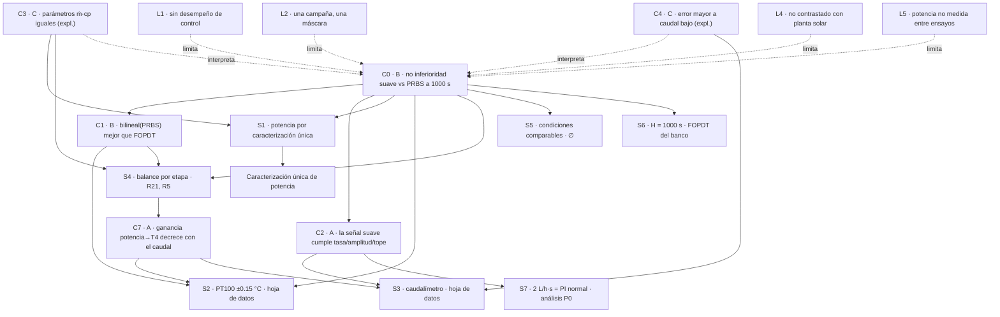

# P3 — Jerarquía de claims y premisas · Banco de emulación termosolar (Tesis Loreto Baima)

Entrada: C-set v1.4 (`P2_Claims.md`), H0 v1 (`P0_H0_Tesis_Loreto.md`, incluidos medibilidad y datos de otros proyectos).
Metodología: `Metodologia-desarrollo-de-articulo-cientifico.md`, sección P3.

**Estado: J2 — P3 cerrada el 2026-11-03 (visto bueno del autor); sigue P4.** P3 se reabrió el 2026-11-03 porque no hay hardware para medir la potencia de forma continua; el autor optó por una caracterización única. Grafo construido por Claude desde las dependencias de P2; existencia, origen y alcance de las premisas, y las hojas que requieren evidencia propia, decididos por el autor (`[AUTOR, 2026-11-03]`).

## Premisas (S#)

| S# | Premisa | Origen | Respaldo | Sostiene a | ¿Acota C0? |
| --- | --- | --- | --- | --- | --- |
| S1 | La potencia de cada resistencia en estado encendido es la obtenida en una caracterización única (tensión y corriente medidas una vez con la resistencia al 100 %) y no varía de forma relevante entre ensayos | derivada (riesgo señalado en P0 por el segundo predictor) | Caracterización única del autor (a realizar antes de la campaña; registro en P5/P6) `[AUTOR, 2026-11-03]` | C0, C3 | Sí: entra en la condición de validez de C0 y en el límite L5 (variación entre ensayos no medida) |
| S2 | Los PT100 (T0–T4) miden con exactitud ±0.15 °C (clase A) en todo el ensayo | implícita típica: calibración | Hoja de datos (P0) | C0, C1 | No, si se cumple: ±0.15 °C < margen de 0.5 °C (R12 de P0) |
| S3 | El caudalímetro mide con resolución de 23.47 L/h y ≈ 1 % de exactitud | implícita típica: calibración | Hoja de datos / análisis del autor (P0) | C2, C4 | No para C0; sí para leer C4 por tramos de caudal |
| S4 | El balance por etapa (mezcla perfecta por colector, cp constante, pérdidas incluidas en los parámetros identificados, sin retardo entre etapas y con un retardo global constante) describe la dinámica de T4 en 200–400 L/h | implícita típica: validez del modelo | R21 (Roca 2008), R5 (Ampuño 2019): misma estructura en campos de colectores; **C7** (no linealidad medida en el banco) `[AUTOR, 2026-11-04]` | C0, C1, C3 | Sí, como condición de validez: régimen 200–400 L/h |
| S5 | Las condiciones del banco que no se manipulan (temperatura ambiente, temperatura de entrada T0, estado inicial) son comparables entre la identificación suave, la identificación PRBS y la validación | derivada (es la debilidad detectada en Bagle 2026, R1) | ∅ (supuesto declarado; se asegura en el diseño de P5) | C0 | Sí: entra en la condición de validez de C0 `[AUTOR, 2026-11-03]` |
| S6 | H = 1000 s (≈ t0 + 4τ del canal caudal→T4) es el horizonte relevante para el MPC del banco | derivada (decisión del autor en P0) | FOPDT identificado con datos del banco (escalones de 2026-01-05) | C0 | Sí, como condición de validez (ya figura) |
| S7 | 2 L/h·s es la tasa máxima de comando que produce el PI en operación normal (definición de "suave") | derivada | Análisis de caudal del autor, P0 (comando PI ≤ ≈ 2 L/h·s) | C2, C0 | Sí, como condición de validez (ya figura) |

**Por qué S1 es aceptable aunque sea débil.** C0 es comparativo: un error de potencia común a las dos ramas afecta a ambos modelos de forma parecida y se cancela en buena parte. El riesgo es que la potencia difiera entre ensayos (por ejemplo, por la tensión de red); eso no se mide y queda como límite declarado L5. Hacer los ensayos cercanos en el tiempo (S5, en P5) reduce ese riesgo.

### Revisión de supuestos implícitos típicos (R8)

| Supuesto típico | Resultado |
| --- | --- |
| Validez del modelo | S4 |
| Calibración de instrumentos | S2 (temperatura), S3 (caudal), S1 (potencia: caracterización única, punto débil declarado en L5) |
| Representatividad de la plataforma | **No aplica como premisa**: C5 se descartó en P2 y las conclusiones se acotan al banco (L4). Confirmado `[AUTOR, 2026-11-03]` |

## Grafo J2

**Aristas "interpreta"** `[AUTOR, 2026-11-03]`. C3 y C4 no sostienen a C0 ni C0 depende de ellos; explican su resultado. C3 pone a prueba el mecanismo que H0 declara en su "porque" (las transiciones de potencia bastan para identificar la interacción con ṁ); C4 localiza en qué tramo de caudal está el error. Así cumplen R10 sin que el estado de C0 dependa de ellos:

| C0 | C3 | Lectura |
| --- | --- | --- |
| se cumple | se cumple | La rama suave identificó la misma física |
| se cumple | falla | Predice bien con otros parámetros: compensación o insensibilidad a 1000 s; se advierte |
| falla | falla | La rama suave identificó mal el término bilineal (mecanismo de falla previsto en P0) |
| falla | se cumple | El término bilineal está bien; el error viene de otra parte (retardo, ruido) |

Con S1 débil, la lectura de C3 es más prudente: una diferencia de parámetros ṁ·cp entre ramas podría deberse en parte a diferencias de potencia no medidas (L5).

## Control

| Control | Resultado |
| --- | --- |
| Ciclos | Ninguno (las aristas "interpreta" van de C3 y C4 a C0; C0 no depende de ellos) |
| Camino a la raíz | C1, C2 → C0 como apoyos; C3, C4 → C0 como "interpreta"; L1, L2, L4, L5 indexados a C0 |
| Propagación (R6) | S1 respaldada por la caracterización única y acotada por L5; S5 (sin respaldo) figura en la condición de validez de C0. Ningún supuesto silencioso |

## Decisiones sobre S1 y S5 `[AUTOR, 2026-11-03]`

- **S1 (potencia).** No hay hardware para medir de forma continua ni para regular la potencia. Se hace una **caracterización única**: tensión y corriente de cada resistencia al 100 %, una vez, antes de la campaña. Ese valor se usa en el modelo. C6 se descarta (retorno RTP a P2) y se crea el límite declarado L5.
- **S5 (condiciones comparables).** Entra en la condición de validez de C0. En P5 se asegura con ensayos cercanos en el tiempo, orden de ramas alternado y registro de T ambiente, T0 y estado inicial.

## Correcciones a P2 (retornos RTP aplicados)

- C2 se evalúa sobre el **comando** (el caudal medido está cuantizado en 23.47 L/h por escalón y filtrado por la hidráulica).
- C6 creado y luego descartado; en su lugar, potencia por caracterización única en la condición de validez de C0 y límite L5.
- Condición de validez de C0 ampliada con condiciones comparables (S5).

## Lectura

C0 se sostiene en dos claims propios (C1: el rival PRBS es un buen modelo; C2: la señal suave cumple su definición) y en siete premisas. La potencia (S1) se apoya solo en una caracterización única y la comparabilidad de condiciones (S5) no tiene respaldo; ambas figuran en la condición de validez de C0. C3 y C4 interpretan su resultado. Lo limitan L1 (solo error de predicción, no control), L2 (una campaña y una máscara de nubes), L4 (banco, no planta solar) y L5 (potencia no medida entre ensayos).

## Entrada para P4 (R13)

- Claims que requieren evidencia propia: C0, C1, C2, C3, C4.
- Premisas que acotan C0: S1 (caracterización única), S5 (sin respaldo).
- Pendientes para P5: protocolo de la caracterización de potencia; cómo asegurar S5; ampliación de L2 a 2 secuencias de nubes.
- Límites: L1, L2, L5 (declarados, dentro del rango), L4 (declarado, fuera de rango); L3 (medido) se crea en P6 si C0 resulta parcial.

## Historial

| Versión | Fecha | Cambio | Motivo |
| --- | --- | --- | --- |
| J0 borrador | 2026-11-03 | Grafo desde el C-set v1; premisas S1–S7; revisión de supuestos implícitos | Inicio de P3 |
| J0 borrador | 2026-11-03 | RTP a P2 aplicado (C2 sobre el comando). S1: el autor prevé medir tensión y corriente de las resistencias y mantener la potencia constante | Decisiones del autor |
| J0 borrador | 2026-11-03 | Aristas "interpreta" C3 → C0 y C4 → C0 (antes C4 figuraba como dependiente de C0) | Decisión del autor |
| J1 | 2026-11-03 | S1 respaldada por C6 (nuevo claim, RTP a P2); S5 en la condición de validez de C0; representatividad confirmada como no aplicable. P3 cerrada | Decisiones del autor |
| J1 | 2026-11-03 | **P3 reabierta** | No hay hardware para medir la potencia de forma continua; el cierre fue prematuro |
| **J2** | 2026-11-03 | S1 respaldada por una caracterización única; C6 descartado (RTP a P2); nuevo límite L5; nodo de caracterización en el grafo | Decisión del autor: solo puede hacer una caracterización única |
| J2 | 2026-11-03 | C1 pasa a tipo B en el grafo. **P3 cerrada** | Decisión y visto bueno del autor |
| J2.1 | 2026-11-04 | C7 respalda S4 (RTP desde P5) | Decisión del autor |
| J2.2 | 2026-11-04 | S4 precisa el retardo: global constante, sin retardo entre etapas | Decisión del autor en P5 |
