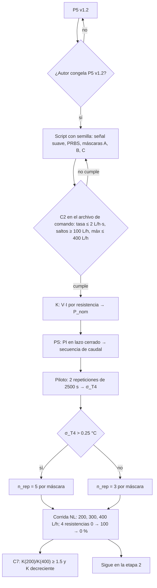
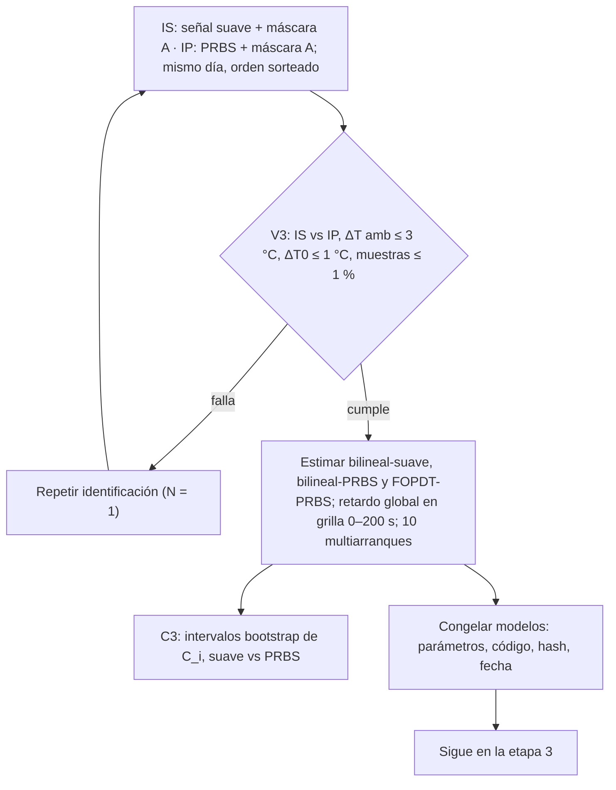
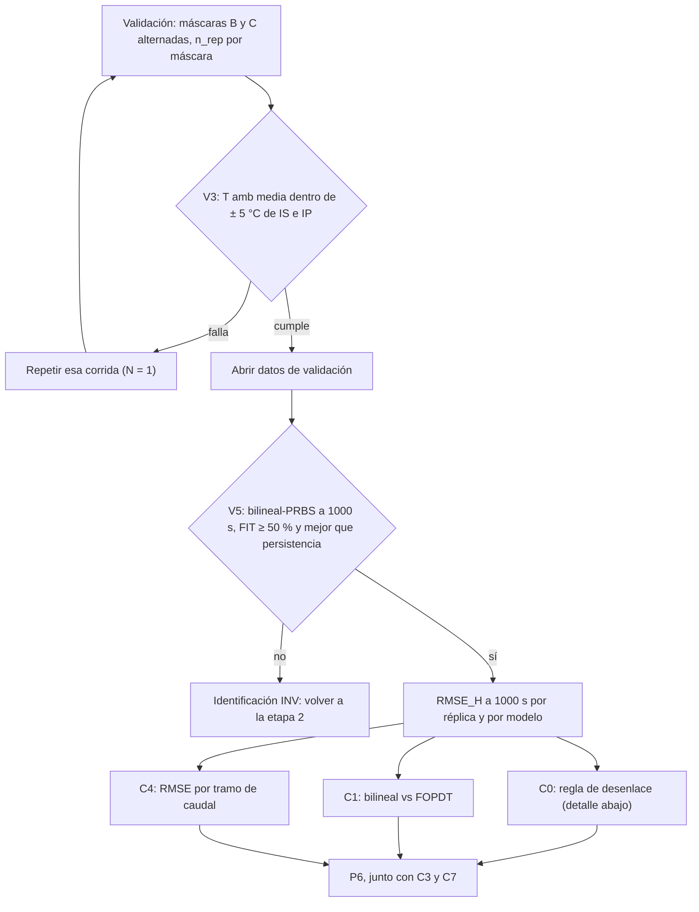
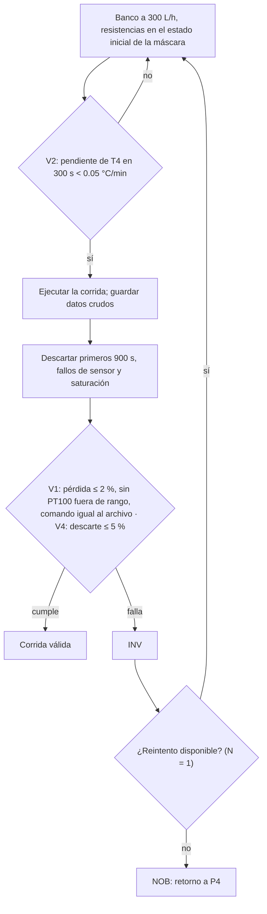
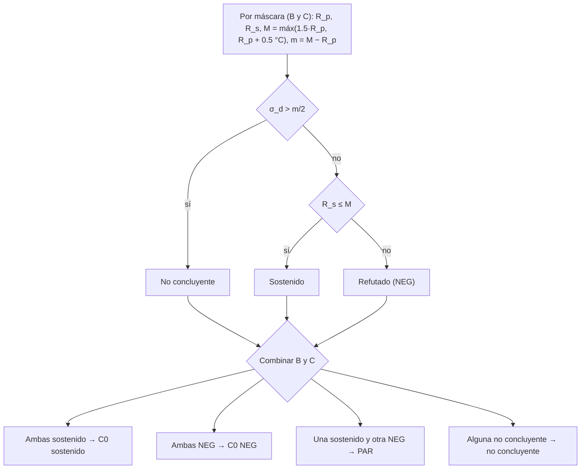

# P5 — Diagrama de flujo (BORRADOR)

Borrador de apoyo, no forma parte del diseño congelado. Resume `P5_Diseno.md` v1.2. Si hay diferencias, manda `P5_Diseno.md`.

## Flujo general

Son tres etapas seguidas. Cada corrida pasa además por el control de la sección siguiente.

### 1. Preparación y corridas iniciales

### 2. Identificación y congelación de modelos

### 3. Validación y análisis

## Control de cada corrida (se aplica a K, PS, P, NL, IS, IP y validación)

## Regla de desenlace de C0

